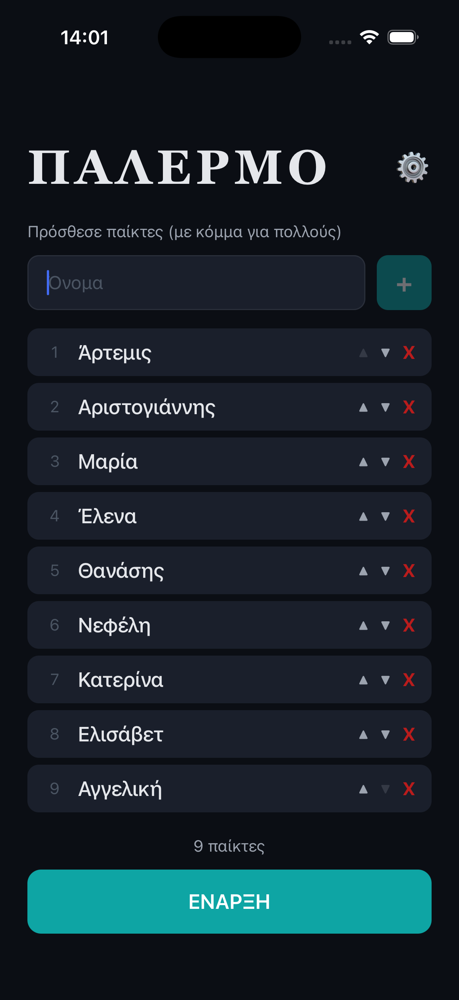
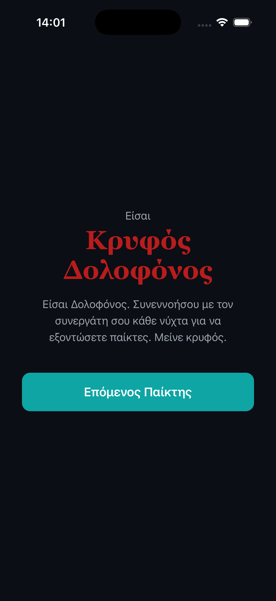
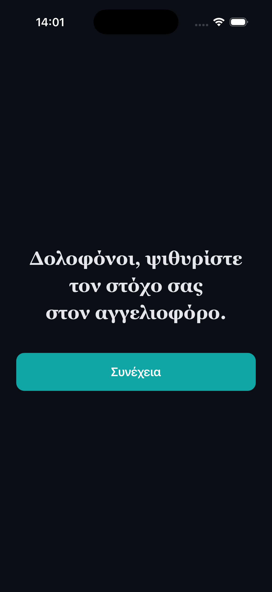
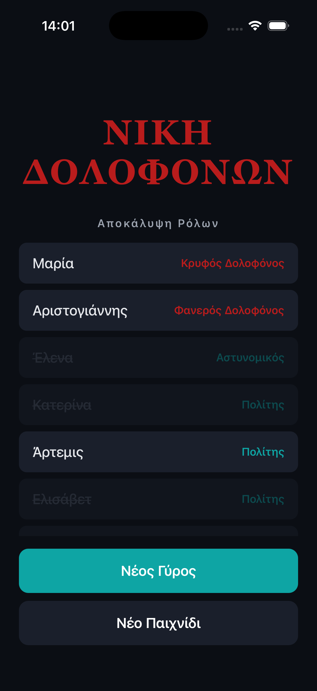

# Palermo

Palermo is the Greek version of the party game Mafia: a few players are secretly killers, everyone else tries to find them, and the group votes someone out every day. This app replaces the human narrator: one phone hands out the roles, reads the night out loud and keeps track of who is still alive, so nobody has to sit out to run the game.

It runs on a single device, fully offline, in Greek and English.

[Download on the App Store](https://apps.apple.com/gr/app/id6759204428) (listed as "Μία Νύχτα στο Παλέρμο")

I posted one video about it and it got about 1,000 users in its first two days.

## Screenshots

<p>
  
  
  
  
</p>

## Running it

You need Node.js 20.19.4 or newer, plus Xcode with an iOS simulator (macOS) or Android Studio with an emulator. The app needs no API keys or `.env` file.

```bash
npm install
npx expo start
```

Press `i` for the iOS simulator or `a` for the Android emulator. Expo installs the right version of Expo Go on the simulator for you.

The app is on Expo SDK 54. The Expo Go app from the App Store or Play Store only supports the latest SDK, so scanning the QR code with your phone will probably not work. Use a simulator, or build the app onto your device with `npx expo run:ios` or `npx expo run:android`.

Before opening a pull request:

```bash
npm test
npm run lint
npx tsc --noEmit
```

To contribute, see [CONTRIBUTING.md](CONTRIBUTING.md). If you use a coding agent, it reads [AGENTS.md](AGENTS.md).

## How the game works

Every game has a Hidden Killer, a Revealed Killer and a Detective. Everyone else is a Citizen. The Doctor, the Informant and the Lovers are optional and are switched on in settings. The base game needs 5 players, the Doctor needs 6, and the Informant or the Lovers need 7.

1. Add the players' names and pick the optional roles.
2. Pass the phone around the table. Each player sees their role in private.
3. On the first night the app narrates while the two killers meet and the Detective learns who the Revealed Killer is.
4. During the day the group talks and votes one player out.
5. At night the killers pick a victim and the Doctor, if there is one, picks someone to save. The app announces who died in the morning.

Days and nights repeat until one side wins:

- Good wins when both killers are dead.
- The Killers win once there are as many killers alive as good players, or more.
- The Lovers win if they are the last two players alive. If one lover dies, the other dies too.

## Code structure

All game rules live in `lib/` as plain TypeScript functions with no React in them, so they can be tested without rendering anything.

```
app/                 Expo Router entry, renders the current phase
components/game/     one screen per phase (setup, role reveal, night, voting, end)
components/ui/       buttons and small shared components
hooks/               reducer with undo history, saved players, narration audio
lib/game-reducer.ts  every state change in the game
lib/role-assignment.ts  shuffles roles and picks the lovers
lib/win-conditions.ts   checks who has won after each death
assets/audio/        narration clips in el/ and en/, plus sound effects
assets/messages/     UI text in Greek and English
__tests__/           unit tests for the rules above
```

The whole game is one `useReducer`. Each action (`START_GAME`, `ELIMINATE_PLAYER`, `ANNOUNCE_VICTIM` and so on) returns the next state, and the reducer runs the win check after every death. The `useGameReducer` hook keeps the last 20 states so the back button can undo a mistap.

Built with Expo SDK 54, React Native 0.81, Expo Router and expo-av.

## License

[MIT](LICENSE)
